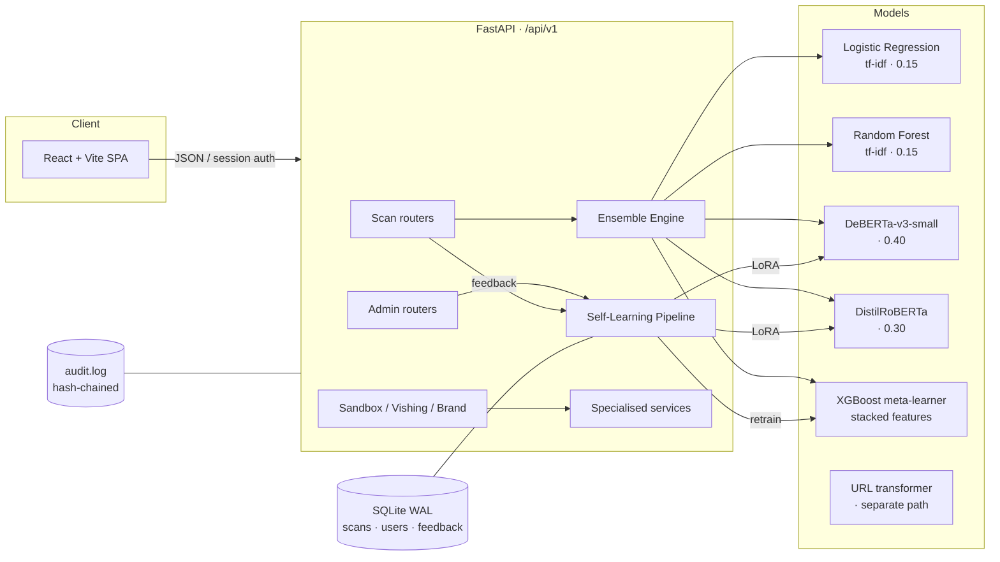

# PhishNot AI

**A self-learning phishing detection platform** — multi-model ML ensemble, explainable verdicts, and a full red-team/brand-protection toolkit in one FastAPI + React application.


---

## Why this exists

Phishing detection products usually ship a single static model. Once deployed, they decay: attackers adapt, new kits appear, and user-reported misses never reach the model.

PhishNot AI attacks the problem from three directions at once:

1. **A stacked ML ensemble** that combines classical n-gram models with transformer semantics, so surface cues *and* intent are scored together.
2. **A self-learning feedback loop** where user verdicts are validated, quarantined, and folded back into retraining — with anti-poisoning defences (canary samples, consensus, trust scoring).
3. **An operator toolkit** — brand protection, browser sandbox, kit fingerprinting, red-team generation — so detection is paired with response.

---

## Feature set

### Core detection
- **Email scanning** — ham / phishing / spam classification with per-model breakdown, calibrated probabilities, and confidence intervals.
- **URL scanning** — lexical features + a dedicated URL transformer (96.3% accuracy, 0.9939 AUC-ROC).
- **Image & QR scanning** — OCR + QR extraction, then URL classification on extracted content.
- **Batch scanning** — multi-item ledger with aggregate risk.
- **Explainability** — LIME word attributions, model voting log, and a written risk narrative with a 0–100 risk score.

### Analysis tooling
- **Header forensics** — SPF/DKIM/DMARC, routing anomalies, spoof signals.
- **Redirect tracer** — full redirect-chain mapping with SSRF-safe fetching.
- **Analyst chat** — LLM-powered Q&A grounded in the scan context (Groq / OpenRouter / Google).
- **Threat intel** — VirusTotal, AlienVault OTX, PhishTank lookups.

### Brand & infrastructure protection
- **DMARC posture checks** for any domain.
- **Lookalike domain monitoring** — homoglyph/typosquat generation and scanning.
- **Phishing kit fingerprinting** — kit signatures + structure extraction.
- **Certificate Transparency logs** — new-cert monitoring per domain.

### Adversarial & red-team
- **Adversarial text generation** — perturbation strategies for robustness testing.
- **Red-team evaluation harness** — repeatable eval runs with per-model metrics and confusion matrices.

### Specialised analyzers
- **Browser sandbox** (Playwright) — loads a URL in a headless browser and reports DOM, injected JavaScript, network requests, screenshot, and a risk summary.
- **OAuth phishing detection** — recognises credential-harvest OAuth consent flows in URLs and emails.
- **Mobile phishing** — SMS, deep-link, and mobile-URL analysis.
- **Vishing** — audio transcription (Whisper) + social-engineering analysis of call transcripts.

### Self-learning system
User feedback doesn't just get logged — it is *defended* before it's learned from:

| Stage | Mechanism |
|---|---|
| Collection | Feedback schema records consensus count, canary flag, quarantine state, submitter trust |
| Poisoning defence | **Canary samples** (5%) detect users who systematically mislabel; **consensus** requires multi-submitter agreement; **trust scoring** down-weights suspicious contributors |
| Quarantine | Mismatching/high-risk feedback is held for admin review before entering training data |
| Retraining | XGBoost meta-learner retrains weekly on validated corrections; **LoRA adapters** fine-tune the transformer monthly; full ensemble retrain quarterly |
| Safety | Auto-validation gates each new model against the incumbent — a regression aborts the swap |

### Admin console
Health, feedback quarantine review, trust scores, whitelists, user roles, audit log (tamper-evident hash chain), training scheduler controls, and red-team results.

---

## Architecture



**Ensemble design.** Each input is scored by four base models; their probabilities are blended with fixed weights (LR 0.15, RF 0.15, DeBERTa 0.40, DistilRoBERTa 0.30). The four per-model probability vectors then form a stacked feature vector that a XGBoost meta-learner consumes for the final verdict — so the meta-learner learns *which base models to trust for which inputs*.

**Self-learning loop.** Scan → user feedback → consensus/canary/quarantine validation → confirmed corrections → meta-learner retrain (weekly) → LoRA fine-tune (monthly) → full retrain (quarterly), each behind an automatic accuracy gate.

---

## Model performance

Ensemble on a held-out evaluation set (`eval_results.json`, 500 samples):

| Metric | Value |
|---|---|
| **Accuracy** | **90.0%** |
| Macro precision / recall / F1 | 0.9002 / 0.9003 / 0.8998 |

Per-class:

| Class | Precision | Recall | F1 |
|---|---|---|---|
| ham | 0.970 | 0.988 | 0.979 |
| phishing | 0.852 | 0.888 | 0.870 |
| spam | 0.878 | 0.825 | 0.851 |

URL transformer: **96.32% accuracy, AUC-ROC 0.9939**.

A per-model ablation study (why an ensemble beats any single model) lives in [`evaluation_results/evaluation_report.md`](evaluation_results/evaluation_report.md).

---

## Quickstart

### Prerequisites
- Python 3.11+
- Node.js 20+
- (Optional) NVIDIA GPU — CPU works, GPU is ~4x faster for transformer inference
- System packages for the OCR/QR features: `tesseract-ocr`, `libzbar0`

### 1. Clone & install

```bash
git clone https://github.com/mirtieza8950-droid/phishnot-ai.git
cd phishnot-ai

python -m venv .venv && source .venv/bin/activate   # Windows: .venv\Scripts\activate
pip install -r requirements.txt
```

### 2. Configure

```bash
cp .env.example .env
# set SESSION_SECRET (python -c "import secrets; print(secrets.token_hex(32))")
# set ADMIN_PASSWORD (any strong password)
```

### 3. Train the models (required before first boot)

Model weights are intentionally not committed — train them from the datasets:

```bash
python training.py                 # base ensemble (LR/RF/DistilBERT/…)
python train_deberta_only.py       # DeBERTa component  (~3.5 h on GPU)
python train_url_transformer.py    # URL transformer     (~96% acc)
python train_meta_learner.py       # XGBoost meta-learner on stacked features
python train_lora_adapters.py      # optional LoRA adapters
```

The API needs `models/ensemble_config.pkl` to boot, so run at least `training.py` first.

> **Note:** if `deberta_dense.pth` is missing, startup logs a warning and the DeBERTa slot contributes untrained scores — train it before any production use.

### 4. Run the backend

```bash
uvicorn app.main:app --reload
```

The API starts on **http://localhost:8000** (`/docs` for interactive Swagger).

### 5. Frontend

```bash
cd frontend
npm install
npm run dev          # dev server on :3000, proxies /api → :8000
npm run build        # production build → frontend/dist, served by FastAPI
```

### 6. Docker (recommended for deployment)

```bash
cp .env.example .env
docker compose up --build
```

The image builds the frontend and installs system OCR dependencies; SQLite databases and `models/` are volume-mounted for persistence.

---

## API overview

Base path: `/api/v1`. Interactive docs at `/docs`.

| Group | Endpoints | Purpose |
|---|---|---|
| **Scanning** | `POST /scan/email`, `/url`, `/image`, `/qr`, `/headers`, `/trace`, `/ask`, `/thinking`, `/visual`, `/report/pdf` | Detection + analysis |
| **Batch** | `POST /batch/` | Multi-item scans |
| **Brand** | `POST /brand/dmarc`, `/lookalikes/scan`, `/kit/fingerprint`, `GET /brand/ct/{domain}` | Brand protection |
| **Sandbox** | `POST /sandbox/scan`, `GET /sandbox/{status,result}/{job_id}` | Headless browser analysis |
| **OAuth** | `POST /oauth/analyze-url`, `/analyze-email`, `GET /oauth/providers` | OAuth phishing |
| **Mobile** | `POST /mobile/analyze-sms`, `/analyze-deeplink`, `/analyze-url` | Mobile threats |
| **Vishing** | `POST /vishing/analyze`, `GET /vishing/{status,result}/{job_id}` | Voice phishing |
| **Adversarial** | `GET /adversarial/strategies`, `POST /generate`, `GET /stats` | Red-team generation |
| **Eval** | `POST /eval/run`, `GET /eval/status`, `/results` | Evaluation harness |
| **History / Audit** | `GET /history/`, `/analytics`, `/audit/log`, `/audit/verify` | Records + integrity |
| **Threat intel** | `GET /threat-intel/lookup` | VT / OTX / PhishTank |
| **Training** | `POST /training/ingest`, `GET /training/ingest/status`, `POST /training/url-model/retrain` | Data ingestion |
| **Admin** | `GET /admin/health`, `POST /admin/retrain`, `GET /admin/feedback/*`, `POST /admin/self-learning/*`, `POST /admin/lora/finetune`, whitelist / trust / users / tranco | Operations |
| **Auth** | `GET /auth/login/{provider}`, `GET /auth/me`, `POST /auth/logout` | Session + OAuth |

Full request/response reference: [`docs/API.md`](docs/API.md).

---

## Project structure

```
├── app/
│   ├── main.py               # FastAPI app, CORS, secure headers, startup
│   ├── api/v1/               # 15 routers (scan, admin, brand, sandbox, …)
│   ├── core/                 # config (pydantic-settings), auth deps, rate limiter
│   ├── db/                   # SQLite helpers + schema migrations (WAL mode)
│   ├── services/             # ensemble engine, self-learning, risk, sandbox, …
│   └── utils/                # SSRF guard, URL features, WHOIS
├── frontend/                 # React 18 + Vite + Tailwind SPA
│   └── src/{pages,components,api}
├── models/                   # trained weights (gitignored — regenerate)
├── training.py, train_*.py   # model training entry points
├── evaluate.py               # evaluation harness
├── test_capabilities.py      # 71 endpoint capability tests
├── test_stress.py            # 64 self-learning stress tests
├── test_deep_pass2.py        # 44 E2E/race-condition tests
├── Dockerfile, docker-compose.yml
└── docs/                     # architecture + API reference
```

---

## Testing

```bash
python test_capabilities.py   # 71/71 — every API capability end-to-end
python test_stress.py         # 64/64 — self-learning pipeline + scheduler
python test_deep_pass2.py     # 44/44 — E2E flows, races, canary defence
```

**Current results: 179/179 passing.**

---

## Tech stack

| Layer | Choices |
|---|---|
| API | FastAPI, Uvicorn, SlowAPI (rate limiting), Pydantic v2 |
| ML | PyTorch, HuggingFace Transformers, PEFT/LoRA, scikit-learn, XGBoost, LIME |
| Data | SQLite (WAL), pandas, numpy |
| Frontend | React 18, Vite 5, Tailwind CSS, Framer Motion, Recharts, Three.js |
| Integrations | Playwright, Whisper, pytesseract, pyzbar, dnspython, python-whois |
| Deploy | Docker, docker-compose |

---

## Project status

**Working today**
- Ensemble inference (email + URL paths), explainability, all 71 API capabilities
- Full self-learning pipeline with poisoning defences (108 stress + E2E tests green)
- All specialised analyzers (sandbox, brand, OAuth, mobile, vishing, red-team)
- Docker build, admin console, session + OAuth auth

**Before production use**
- [ ] Train the DeBERTa component (`train_deberta_only.py`) — currently untrained weights
- [ ] Swap the local Qwen2-VL vision model for an API-backed VL model (local load is too slow on a 6 GB GPU)
- [ ] Set real `.env` secrets and enable an external threat-intel key
- [ ] Review the deployment target (see `docs/ARCHITECTURE.md` — SQLite + scheduler need a long-running host, not serverless)

---

## License

MIT — see [LICENSE](LICENSE).
